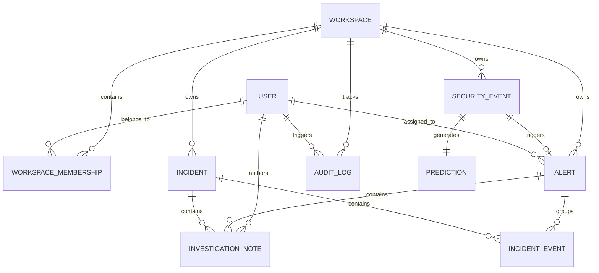

# CybeWatch AI — Database Design & Schema

CybeWatch AI utilizes SQLAlchemy declarative models with dual compatibility for **PostgreSQL** in production and **SQLite** in zero-setup development environments.

## 1. Entity-Relationship Model

## 2. Table Specifications

### `users`
- `id` (VARCHAR(36), PK): UUID identifier
- `email` (VARCHAR(255), UNIQUE, INDEX): Analyst email
- `hashed_password` (VARCHAR(255)): Bcrypt password hash
- `full_name` (VARCHAR(255)): Analyst name
- `role` (ENUM: admin, analyst, viewer): RBAC authorization
- `is_active` (BOOLEAN): Status flag

### `workspaces`
- `id` (VARCHAR(36), PK): UUID identifier
- `name` (VARCHAR(255)): Workspace title (e.g. Primary SOC)
- `slug` (VARCHAR(255), UNIQUE, INDEX): Slug identifier (`soc-primary`)
- `description` (TEXT): Description

### `security_events`
- `id` (VARCHAR(36), PK): Event UUID
- `workspace_id` (VARCHAR(36), FK): Associated workspace
- `event_timestamp` (DATETIME, INDEX): Packet flow timestamp
- `source_ip` (VARCHAR(64), INDEX): Inbound / originator IP
- `destination_ip` (VARCHAR(64), INDEX): Target host IP
- `source_port`, `destination_port` (INT): Transport layer ports
- `protocol` (VARCHAR(16), INDEX): tcp, udp, icmp
- `service` (VARCHAR(32)): http, dns, ssh, ssl, ftp, etc.
- `duration` (FLOAT): Flow duration in seconds
- `src_bytes`, `dst_bytes` (INT): Payload bytes transferred
- `src_pkts`, `dst_pkts` (INT): Packets transferred
- `sload`, `dload` (FLOAT): Source and destination bitrates
- `sttl`, `dttl` (INT): Time-to-live headers
- `loss_rate` (FLOAT): Packet loss ratio
- `is_synthetic` (BOOLEAN): Test / synthetic traffic flag

### `predictions`
- `id` (VARCHAR(36), PK): UUID
- `event_id` (VARCHAR(36), FK, UNIQUE): Linked security event
- `predicted_category` (VARCHAR(64), INDEX): Benign, DoS, PortScan, BruteForce, Botnet, Exploits
- `is_threat` (BOOLEAN, INDEX): Threat boolean flag
- `threat_score` (FLOAT, INDEX): Confidence score [0.0 - 1.0]
- `severity` (ENUM): benign, low, medium, high, critical
- `feature_contributions` (JSON): Top positive and negative feature decision drivers
- `latency_ms` (FLOAT): Inference latency in milliseconds

### `alerts`
- `id` (VARCHAR(36), PK): Alert UUID
- `workspace_id` (VARCHAR(36), FK, INDEX): Workspace isolation
- `event_id` (VARCHAR(36), FK, UNIQUE): Linked malicious event
- `title` (VARCHAR(255)): Alert headline
- `category` (VARCHAR(64), INDEX): Attack category
- `severity` (ENUM): Severity ranking
- `threat_score` (FLOAT): Model score
- `status` (ENUM, INDEX): new, triaged, investigating, resolved, false_positive
- `assigned_to_id` (VARCHAR(36), FK): Assigned analyst
- `mitre_technique` (VARCHAR(128)): MITRE ATT&CK reference code
- `summary` (TEXT): SOC triage description

### `incidents`
- `id` (VARCHAR(36), PK): Incident UUID
- `incident_number` (VARCHAR(32), UNIQUE): Reference code (`INC-202610-0023`)
- `title` (VARCHAR(255)): Campaign title
- `status` (ENUM): open, investigating, contained, resolved, closed
- `severity` (ENUM): Lead severity
- `lead_source_ip` (VARCHAR(64), INDEX): Adversary IP
- `correlation_rule` (VARCHAR(128)): Triggering clustering rule

### `audit_logs`
- `id` (VARCHAR(36), PK): Audit record UUID
- `workspace_id` (VARCHAR(36), FK): Isolation
- `user_id` (VARCHAR(36), FK): Actor
- `action` (VARCHAR(64)): Action name (`ALERT_STATUS_UPDATE`, `ALERT_ASSIGNMENT`)
- `resource_type` (VARCHAR(64)): Target entity type
- `resource_id` (VARCHAR(36)): Target entity UUID
- `details` (JSON): Old state vs new state details
